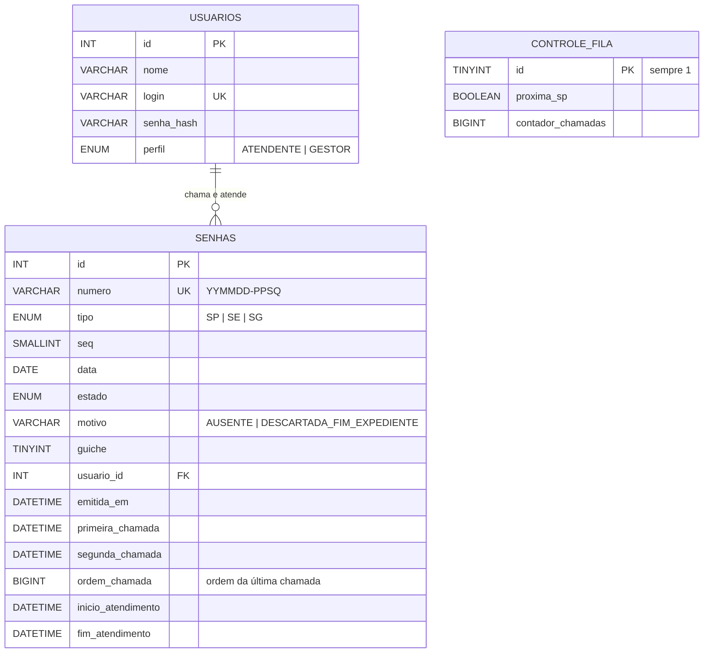

# MER — Modelo Entidade-Relacionamento

Banco MySQL 8.0 `nassautickets`. Script de criação: `backend/sql/schema.sql`.

## Entidades

### usuarios
Atendentes e gestores que acessam o sistema.

| Campo | Tipo | Descrição |
|-------|------|-----------|
| id | INT, PK | Identificador. |
| nome | VARCHAR(100) | Nome exibido e usado na auditoria. |
| login | VARCHAR(50), único | Login de acesso. |
| senha_hash | VARCHAR(100) | Senha em hash bcrypt. |
| perfil | ENUM | `ATENDENTE` ou `GESTOR`. |

### senhas
Cada senha emitida no totem e todo o seu histórico.

| Campo | Tipo | Descrição |
|-------|------|-----------|
| id | INT, PK | Identificador. |
| numero | VARCHAR(14), único | Número `YYMMDD-PPSQ`, ex.: `261126-SG004`. |
| tipo | ENUM | `SP`, `SE` ou `SG`. |
| seq | SMALLINT | Sequência do tipo no dia. |
| data | DATE | Dia da emissão. |
| estado | ENUM | Estado atual (ver máquina de estados). |
| motivo | VARCHAR(40), opcional | Por que virou NÃO_COMPARECEU. |
| guiche | TINYINT, opcional | Guichê que chamou. |
| usuario_id | INT, FK, opcional | Atendente que chamou. |
| emitida_em | DATETIME | Horário da emissão. |
| primeira_chamada / segunda_chamada | DATETIME(3), opcional | Horários das chamadas, com milissegundos. |
| ordem_chamada | BIGINT, opcional | Número de ordem da última chamada (1ª, 2ª, 3ª…). O painel ordena por ele, e não pelo relógio, para continuar certo mesmo se a hora do computador mudar. "Chamar novamente" gera um número novo. |
| inicio_atendimento / fim_atendimento | DATETIME, opcional | Usados no cálculo do TM. |

Restrições: `UNIQUE (data, tipo, seq)` garante uma única sequência por tipo e por dia; o índice `idx_fila (data, tipo, estado, seq)` acelera a busca da próxima senha.

### controle_fila
Tabela de uma linha só (id = 1). Tem três funções:
- **Trava de concorrência:** emissão e chamada fazem `SELECT … FOR UPDATE` nesta linha, então são processadas uma de cada vez.
- **Alternância de prioridade:** `proxima_sp` indica se a próxima chamada deve ser SP (RN01).
- **Contador de chamadas:** `contador_chamadas` guarda o último número de ordem usado; cada chamada soma 1 e grava o valor em `senhas.ordem_chamada`.

## Relacionamento

**usuarios 1 : N senhas** — um atendente chama e atende várias senhas; uma senha é chamada por no máximo um atendente (`usuario_id` fica vazio enquanto a senha está na fila).
