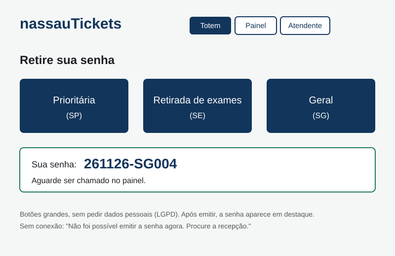
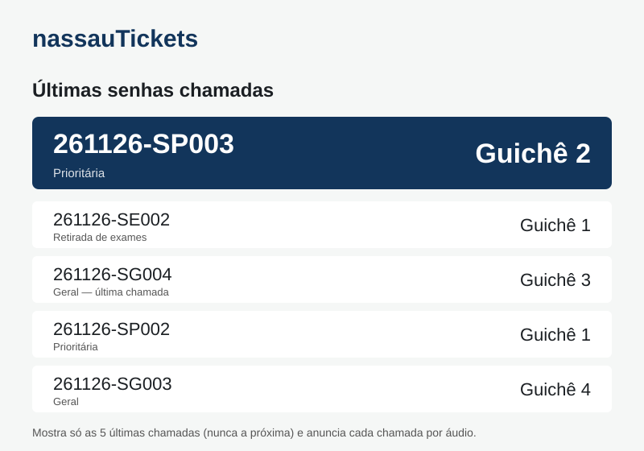
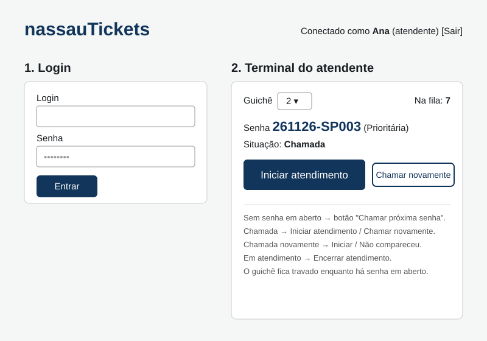
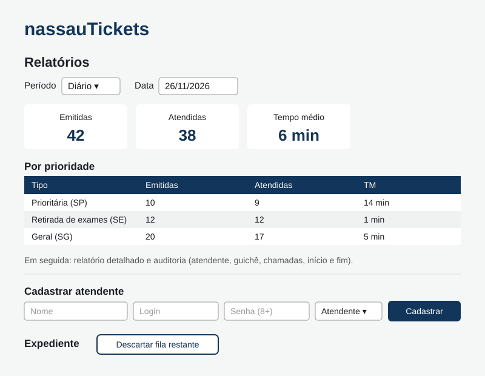

# Mockups

Esboços das telas do sistema, com as cores do [branding](../branding/branding.md). Os números de senha e valores são exemplos.

## Totem (cliente)
Escolha do tipo de atendimento e exibição da senha emitida.

## Painel
Últimas 5 senhas chamadas, a mais recente em destaque. Não mostra a próxima da fila.

## Login e terminal do atendente
Login, escolha do guichê, senha atual e ações de acordo com o estado.

## Gestor
Relatórios diário/mensal, cadastro de atendentes e encerramento do expediente.

