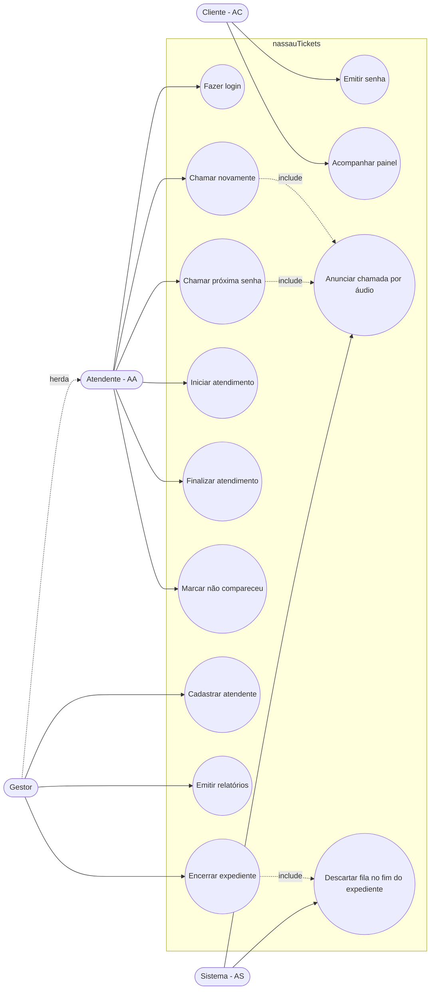

# Diagrama de casos de uso

## Descrição dos casos de uso

| Caso de uso | Ator | Pré-condição | Fluxo principal | Exceções |
|-------------|------|--------------|-----------------|----------|
| Emitir senha | AC | Dentro do expediente (7h–17h) | Cliente escolhe SP, SE ou SG; sistema gera o número `YYMMDD-PPSQ` e coloca a senha na fila (AGUARDANDO). | Fora do expediente: emissão recusada. Sem conexão: "Procure a recepção". |
| Acompanhar painel | AC | — | Painel mostra as 5 últimas chamadas e o guichê, sem mostrar a próxima. | Sem conexão: mantém as últimas chamadas e avisa. |
| Fazer login | AA | Atendente cadastrado | Informa login e senha; sistema devolve a sessão. | Login ou senha inválidos. |
| Chamar próxima senha | AA | Logado, guichê escolhido, sem atendimento em aberto | Sistema escolhe a próxima senha pela RN01, marca CHAMADA e o painel anuncia. | Fila vazia; atendimento em aberto (409); fora do expediente. |
| Chamar novamente | AA | Senha em CHAMADA | Senha passa para CHAMADA_NOVAMENTE; painel anuncia "Última chamada". | — |
| Iniciar atendimento | AA | Senha em CHAMADA ou CHAMADA_NOVAMENTE | Senha passa para EM_ATENDIMENTO e o início é registrado. | — |
| Finalizar atendimento | AA | Senha EM_ATENDIMENTO | Senha passa para ATENDIDA e o fim é registrado. | — |
| Marcar não compareceu | AA | Senha em CHAMADA_NOVAMENTE | Senha passa para NÃO_COMPARECEU (motivo AUSENTE) e sai do painel. | — |
| Cadastrar atendente | Gestor | Logado como gestor | Informa nome, login, senha (mín. 8 caracteres) e perfil. | Login já existe; dados inválidos. |
| Emitir relatórios | Gestor | Logado como gestor | Escolhe diário ou mensal e a data; vê totais, por prioridade, TM, detalhado e auditoria. | Data inválida. |
| Encerrar expediente | Gestor | Logado como gestor | Senhas AGUARDANDO após as 17h (ou de dias anteriores) são descartadas. | — |
