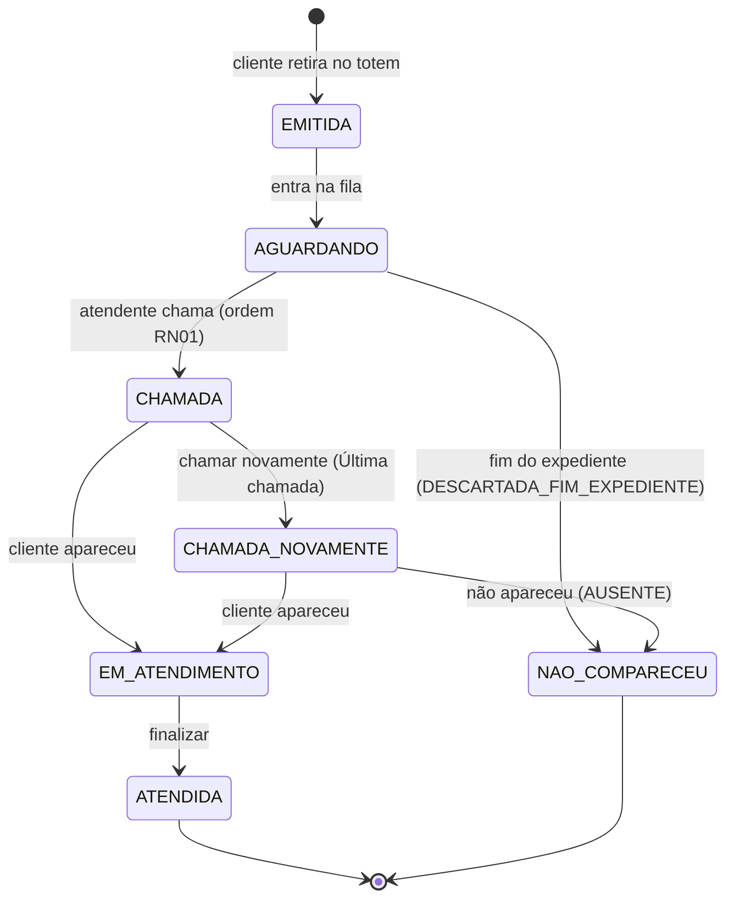

# Máquina de estados da senha

## Estados

| Estado | Significado | Registro no banco |
|--------|-------------|-------------------|
| EMITIDA | Senha acabou de ser gerada no totem. | `emitida_em` |
| AGUARDANDO | Na fila, esperando ser chamada. | — |
| CHAMADA | Chamada no painel pela 1ª vez. | `primeira_chamada`, `guiche`, `usuario_id` |
| CHAMADA_NOVAMENTE | Chamada pela 2ª e última vez. | `segunda_chamada` |
| EM_ATENDIMENTO | Cliente está no guichê. | `inicio_atendimento` |
| ATENDIDA | Atendimento concluído (estado final). | `fim_atendimento` |
| NÃO_COMPARECEU | Abandonada ou descartada (estado final). | `motivo` |

Observação: na implementação, EMITIDA e AGUARDANDO acontecem na mesma transação; a senha já é gravada como AGUARDANDO.

Transições inválidas (por exemplo, finalizar uma senha que não está em atendimento, ou mexer na senha de outro atendente) são recusadas pela API com erro 409.
